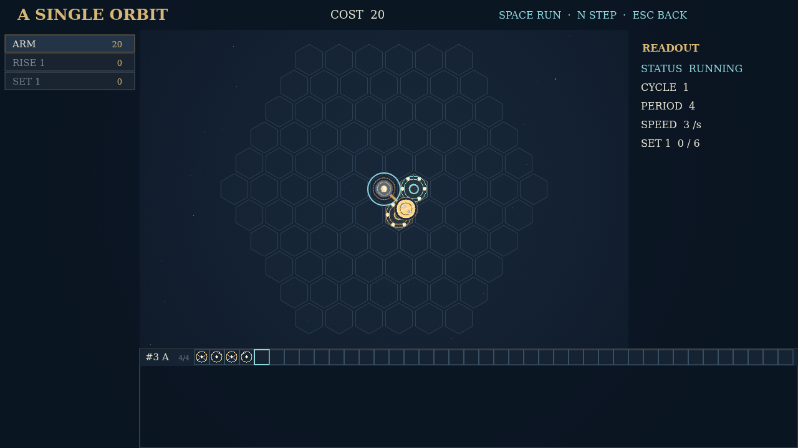

# Orrery

A little sky waits inside a brass instrument. Its stars arrive one constellation at a time, and the machine you build must guide each one from its rise to the set that will accept it. An empty hex field gives you room to imagine the route. A placed arm gives that route motion. What first looks like a clockwork diagram becomes a small choreography of grasping, turning, and release.

Take parts from the tray and place them directly on the field. Engrave sigils where matter should change: bind motes with filaments, split them apart, raise a planet, or turn a handful of dust into an eclipse. Wheels carry their own celestial fixtures, while tracks let arms travel between stations. Select an arm and write its tape one glyph at a time. Every arm reads the same repeating cycle, so the timing of one small move can change the entire machine.

Start the run to watch the mechanism work. Motes sweep along the arms' paths, meet the sigils, and collect at the sets. A collision stops everything where it happened, leaving the field visible so you can diagnose the fault. Step through a cycle, adjust the tape, and try again. Deliver six of every requested product to finish, then refine your design for lower cost, fewer cycles, and a smaller footprint.

Campaign offers eight linked instruments that open in sequence, from one clean orbit to denser assemblies. Extras is a shelf of ten fixed puzzles for experimenting with individual rules and difficult transformations. Your machines and best records stay with each challenge for the session, so you can return to a working design and make it more elegant.

